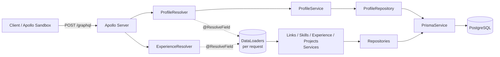
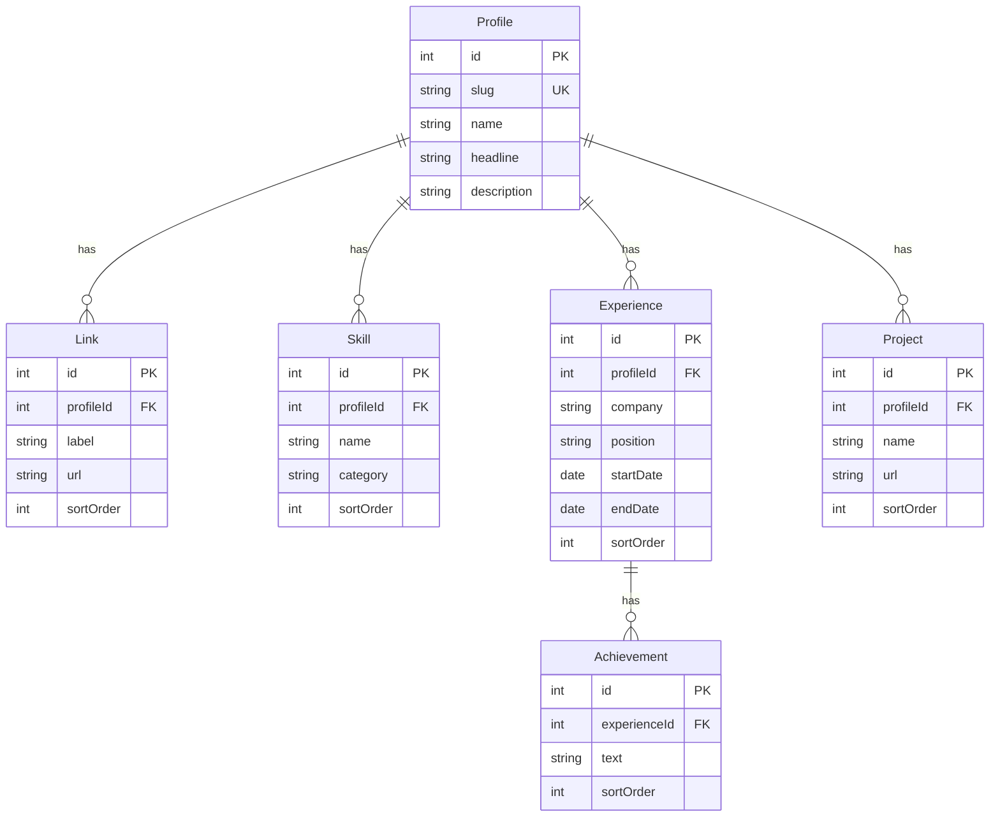

# Цифровая визитка — GraphQL backend

Backend-приложение, которое представляет разработчика: профиль, ссылки, навыки, опыт работы с достижениями и проекты. Данные отдаются через GraphQL API, для работы с ним в браузере есть **Apollo Sandbox**.

**Стек:** TypeScript · Node.js 22 · NestJS 11 · GraphQL (Apollo Server 5, code-first) · Prisma 6 · PostgreSQL 16 · Docker · Jest · GitHub Actions

| | |
|---|---|
| Деплой (Apollo Sandbox) | `https://<your-app>.onrender.com/graphql` <!-- TODO: подставить ссылку после деплоя --> |
| Репозиторий | `https://github.com/<your-github>/it-solutions-assignment` <!-- TODO --> |

---

## Быстрый старт

Нужен только Docker.

```bash
docker compose up --build
```

Откройте **http://localhost:3000/graphql**, там будет Apollo Sandbox.

При старте контейнер `app`:

1. дожидается PostgreSQL (`depends_on: service_healthy` плюс повторные попытки миграции);
2. применяет миграции через `prisma migrate deploy`;
3. запускает идемпотентный seed с данными автора;
4. запускает приложение.

Чтобы начать полностью с нуля: `docker compose down -v && docker compose up --build`.

### Пример запроса

```graphql
query {
  profile {
    name
    headline
    description
    links { label url }
    skills { name category }
    experience {
      company
      position
      startDate
      endDate
      isCurrent
      achievements { text }
    }
    projects { name description url }
  }
}
```

Запрос из задания (`profile { name description skills { name } experience { company position } projects { name } }`) работает без изменений. Аргумент `slug` необязателен: без него возвращается владелец визитки, с ним можно запросить конкретный профиль: `profile(slug: "stas-kolkovsky")`.

Полная схема лежит в [`schema.gql`](./schema.gql). Файл генерируется из кода и закоммичен как контракт API.

### Локальная разработка без Docker для приложения

```bash
cp .env.example .env
docker compose up -d postgres   # только БД
npm ci
npm run db:deploy               # миграции
npm run db:seed                 # данные
npm run start:dev               # http://localhost:3000/graphql
```

| Команда | Назначение |
|---|---|
| `npm run start:dev` | dev-сервер с hot reload |
| `npm run build` | сборка приложения и seed в `dist/` |
| `npm run lint` | ESLint (type-aware) + Prettier |
| `npm test` | unit-тесты |
| `npm run test:e2e` | e2e-тесты против отдельной БД `business_card_test` |
| `npm run db:migrate` | создать новую миграцию (`prisma migrate dev`) |
| `npm run db:seed` | синхронизировать БД с `prisma/seed-data.ts` |

Переменные окружения валидируются при старте (`src/config/env.schema.ts`). Если конфигурация неверна, приложение сразу завершается с понятной ошибкой.

| Переменная | По умолчанию | Описание |
|---|---|---|
| `DATABASE_URL` | — (обязательная) | строка подключения PostgreSQL |
| `PORT` | `3000` | HTTP-порт |
| `NODE_ENV` | `development` | `development` / `production` / `test` |
| `GRAPHQL_MAX_DEPTH` | `6` | максимальная глубина GraphQL-запроса |
| `LOG_SQL` | `false` | логировать каждый SQL-запрос Prisma |
| `SEED_ON_START` | `true` | запускать seed при старте контейнера |

---

## Архитектура



```
src/
  main.ts, app.module.ts
  config/        валидация env (zod) + типизированный AppConfigService
  prisma/        PrismaModule / PrismaService (жизненный цикл, логирование SQL)
  graphql/       настройка GraphQLModule, контекст запроса, маппинг ошибок
  dataloader/    фабрика DataLoader'ов и декоратор @RequestLoaders()
  common/        groupByKey, скаляр LocalDate
  profile/       Query.profile + поля-связи профиля
  links/ skills/ projects/        repository + service + GraphQL-модель
  experience/    repository + service + resolver (achievements, isCurrent)
  health/        GET /health (с проверкой БД)
prisma/
  schema.prisma, migrations/
  seed-data.ts   данные автора (только данные)
  seed.ts        логика синхронизации
test/            e2e-тесты и подготовка тестовой БД
```

### Разделение ответственности

| Слой | Отвечает за | Не знает о |
|---|---|---|
| **Resolver** | отображение GraphQL-схемы: аргументы, поля, выбор DataLoader'а | Prisma, SQL |
| **Service** | бизнес-правила: выбор профиля по умолчанию, `NotFound`, группировка батчей по ключам, `isCurrent` | GraphQL, Prisma API |
| **Repository** | запросы к БД через Prisma: фильтры, сортировка | GraphQL, бизнес-правилах |

Сервисы бросают транспортно-независимые `HttpException` из Nest. `formatGraphQLError` переводит их в стандартные GraphQL-коды (`NOT_FOUND`, `BAD_USER_INPUT`…) и не отдаёт клиенту внутренние детали.

GraphQL-модели (`*.model.ts`) отделены от моделей Prisma, поэтому схема API и схема БД могут меняться независимо.

---

## Обоснование решений

### Code-first GraphQL
Типы описаны TypeScript-классами с декораторами, SDL генерируется автоматически. Источник правды один, поэтому схема и резолверы не расходятся, а компилятор проверяет типы. Сгенерированный `schema.gql` закоммичен, и изменения контракта видны в diff'е PR.

### Решение проблемы N+1: `@ResolveField` + DataLoader
Связи профиля не подгружаются «жадно» через `include`. Каждая связь резолвится отдельным `@ResolveField`, поэтому:

- в БД запрашивается только то, что запросил клиент: без `projects` в запросе нет и SQL к `Project`;
- все обращения к одной связи в рамках запроса собираются DataLoader'ом в **один** `SELECT … WHERE "fk" IN (…)`.

Полный запрос профиля всегда выполняется за **6 SQL-запросов**: profile, links, skills, experience, projects и achievements для *всех* мест работы сразу. Число не зависит от количества записей. Это зафиксировано e2e-тестом: в нём добавляется ещё 10 мест работы с достижениями, и проверяется, что запросов по-прежнему 6. Проверить вручную можно так: `LOG_SQL=true docker compose up`.

**Почему DataLoader'ы создаются в GraphQL-контексте, а не как `Scope.REQUEST`-провайдеры.** Request-scope в Nest распространяется вверх по графу зависимостей: каждый резолвер и сервис стал бы пересоздаваться на каждый запрос. Здесь синглтон `LoadersFactory` создаёт свежий набор loader'ов в `context()` на каждый HTTP-запрос. Кэш изолирован между запросами, а DI-граф остаётся синглтонным.

Батч-функция DataLoader'а должна вернуть результаты строго в порядке ключей. Эту задачу решает `groupByKey`, он покрыт unit-тестами.

### Защита API
- `graphql-depth-limit` (`GRAPHQL_MAX_DEPTH`) отклоняет слишком глубокие запросы на этапе валидации, ещё до обращения к БД;
- в production не отдаются stack trace'ы.

### Модель данных



- Все связи один-ко-многим с `ON DELETE CASCADE`.
- **Естественные составные уникальные ключи** (`[profileId, name]`, `[profileId, company, startDate]`, `[experienceId, sortOrder]` …) решают две задачи сразу: дают seed'у ключ для `upsert` и, поскольку начинаются с внешнего ключа, служат индексом для батч-запросов `WHERE profileId IN (…)`. Отдельные индексы по FK не нужны.
- `sortOrder` задаёт порядок отображения явно, а не по случайному `id`.
- Даты работы хранятся как `DATE` (без времени) и отдаются кастомным скаляром `LocalDate` (`YYYY-MM-DD`). `endDate = null` означает «по настоящее время», отсюда вычисляемое поле `isCurrent`.
- Поддерживается несколько профилей (`slug`). Без аргумента `profile` возвращает владельца визитки, то есть первый созданный профиль.

### Инициализация и seed
- **Миграции** версионируются в `prisma/migrations` и применяются через `prisma migrate deploy`. Эта команда ничего не удаляет и безопасна для production.
- **Данные отделены от логики.** `seed-data.ts` — типизированный объект с данными автора, `seed.ts` — синхронизация.
- **Seed идемпотентен и работает как синхронизация.** В одной транзакции он делает `upsert` по естественным ключам и удаляет записи, которых больше нет в `seed-data.ts`. Повторный запуск даёт то же состояние, `id` стабильны. Поэтому seed безопасно запускать на каждом старте контейнера, а правка визитки сводится к правке `seed-data.ts` и рестарту.

### Docker
- Multi-stage сборка. Стадия `build` ставит все зависимости, компилирует приложение и seed (в JS, без `ts-node` в рантайме), затем делает `npm prune --omit=dev`. Стадия `runtime` содержит только `dist`, prod-зависимости, схему и миграции.
- Контейнер работает от пользователя `node`, а не от root. PID 1 — `tini`, поэтому сигналы корректно доходят до Node и срабатывает graceful shutdown (`enableShutdownHooks` + `$disconnect`). В образе есть `HEALTHCHECK` на `/health`, который проверяет и БД.
- Entrypoint повторяет `migrate deploy`, пока БД недоступна. Это нужно на платформах, где нет `depends_on: service_healthy`.

### Тесты
- **Unit** (`src/**/*.spec.ts`): сервисы с замоканными репозиториями, `groupByKey`, скаляр `LocalDate`, валидация env.
- **e2e** (`test/`): полноценное приложение и настоящий PostgreSQL. Проверяются вложенный запрос, запрос из задания, `NOT_FOUND`, лимит глубины, **фиксированное число SQL** и идемпотентность seed.
- e2e работают только с БД, имя которой оканчивается на `_test`. Global setup применяет миграции и очищает таблицы, а для любой другой БД отказывается запускаться.

### CI
GitHub Actions: lint → build → unit → e2e (Postgres как service container), затем `docker compose up --build` с нуля и smoke-тест GraphQL.

### Выбор версий
- **NestJS 11 (CommonJS)**, а не 12. Ветка 12 только ESM, а в связке Jest, Prisma 6 и CommonJS-экосистемы GraphQL это заметно усложняет инструментарий без пользы для задачи.
- **Prisma 6**: стабильный `prisma-client-js` без обязательных driver adapters. Миграция на Prisma 7 (`prisma.config.ts`, новый генератор) — отдельная задача.

---

## Деплой

В репозитории есть [Render Blueprint](./render.yaml): Docker web service и managed PostgreSQL 16.

1. Запушить репозиторий на GitHub.
2. Render → **New → Blueprint** → выбрать репозиторий.
3. После деплоя открыть `https://<service>.onrender.com/graphql`.

Миграции и seed выполняются автоматически при каждом деплое. Подойдёт и любая другая платформа с Docker (Railway, Fly.io): нужно только передать `DATABASE_URL`. `PORT` берётся из окружения.

---

## Ограничения и возможные улучшения

- **Размер образа.** Prisma CLI с движками (~200 МБ) нужен в рантайме только для `migrate deploy`. Можно вынести миграции в отдельный job или init-контейнер и оставить в образе приложения только `@prisma/client`.
- **Seed на каждом старте** удобен для визитки, но для реальных данных его лучше запускать отдельной командой релиза.
- **Нет мутаций и аутентификации.** Данные редактируются через `seed-data.ts`. Следующий шаг — мутации под guard'ом.
- **Глубина ограничена, сложность — нет.** Для публичного API со списками стоит добавить query complexity (`graphql-query-complexity`) и пагинацию.
- **Кэширование.** Данные почти статичны, поэтому подойдут HTTP cache / APQ / response cache plugin Apollo.
- **S3.** Логичное расширение — аватар и файл резюме в S3 с presigned URL в поле `Profile.avatarUrl`.
